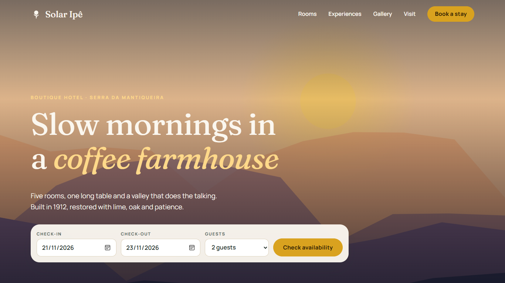
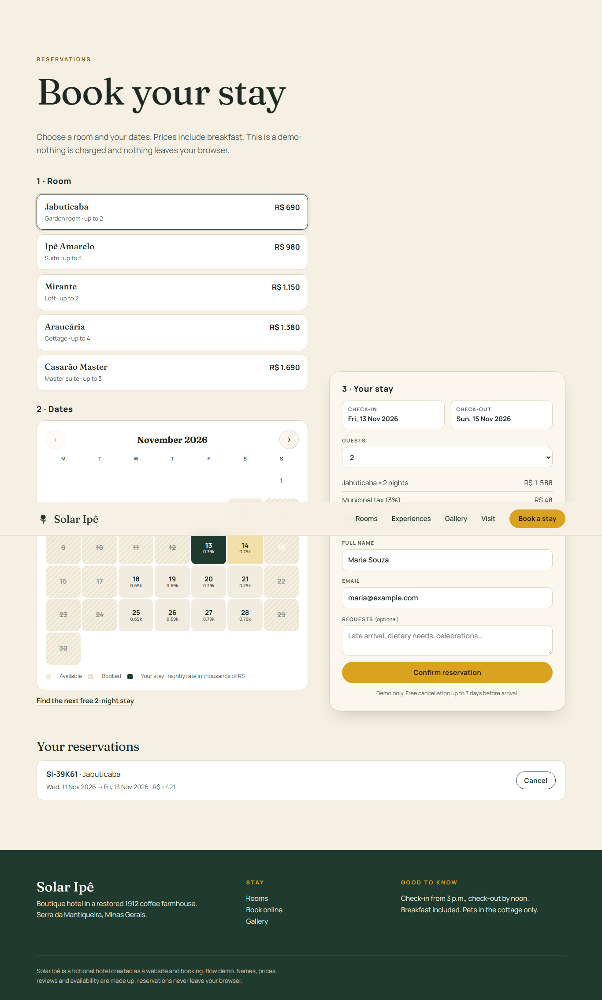
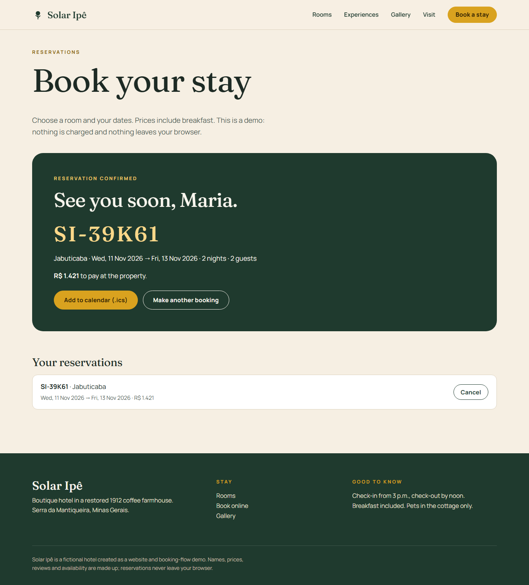
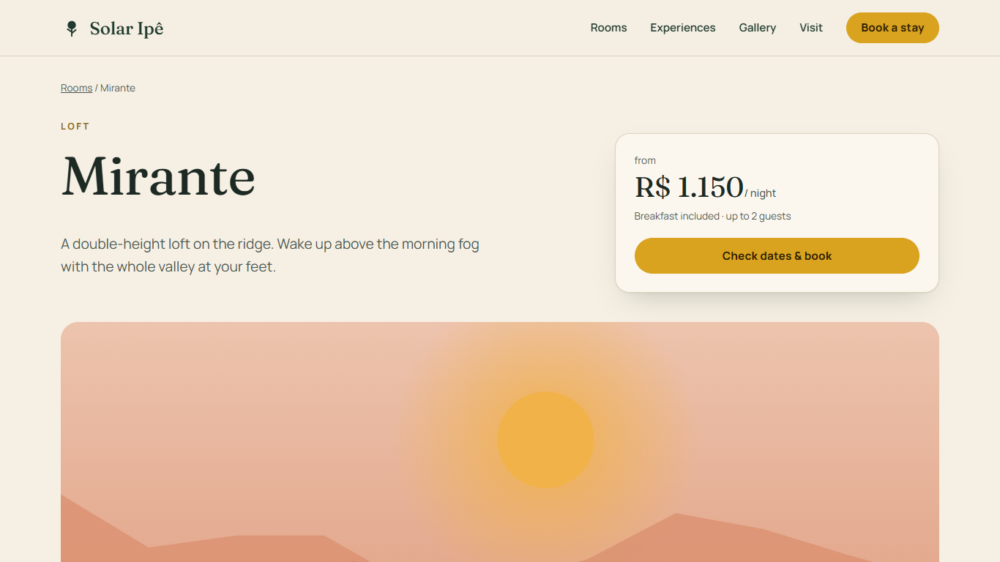
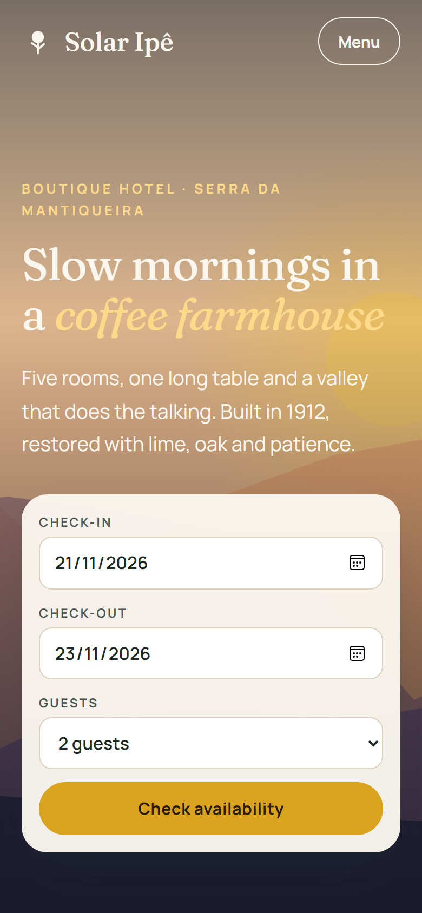

# Solar Ipê — boutique hotel website

A complete website and booking flow for a fictional boutique hotel in a restored 1912 coffee farmhouse (Serra da Mantiqueira, Brazil).

**Live demo:** https://alissonlittig.github.io/solar-ipe-hotel/

> Solar Ipê is a made-up hotel. Names, prices, reviews and availability are fictional demo data. Reservations are stored only in the visitor's browser (`localStorage`); nothing is sent to a server.



## What it does

- **Home page** with hero, availability search, room cards showing the next free date, experiences, an illustrated gallery with an accessible lightbox (`<dialog>`, keyboard arrows), guest reviews and a "how to get here" block.
- **Five room pages** (`/rooms/<slug>/`) with specs, features and a booking call to action.
- **Booking flow** (`/book/`): pick a room, pick a range on a live availability calendar (nightly price on each day, booked nights struck through), see an itemised quote, enter guest details, get a reference code and a downloadable `.ics` calendar file. Reservations can be listed and cancelled; a guest's own bookings block those nights.
- **Pricing rules:** +15% on Friday/Saturday nights, +20% in Dec–Feb and July, 10% long-stay discount from 5 nights, 3% municipal tax, 2-night minimum when a Saturday is included, 14-night online maximum, guest count limited per room.

| Booking | Confirmation |
| --- | --- |
|  |  |

| Room page | Mobile (390 px) |
| --- | --- |
|  |  |

## Stack

- **SvelteKit 2 + Svelte 5** (runes), fully prerendered with `adapter-static`
- Plain CSS with custom properties; self-hosted variable fonts (Fraunces, Manrope)
- Procedural SVG illustrations instead of stock photography (zero image weight, no licensing)
- **Vitest** for the booking logic (dates, pricing, validation, deterministic availability)
- **GitHub Actions**: test → build → deploy to GitHub Pages

## Run it

```bash
npm ci
npm test            # unit tests for pricing, validation and availability
npm run dev         # http://localhost:5173
BASE_PATH=/solar-ipe-hotel npm run build   # static site in ./build
```

## Notes on the design

- The booking logic (`src/lib/booking.js`) is pure functions on ISO date strings with UTC arithmetic, so DST and time zones cannot shift a night. Pricing uses integer percentages to avoid floating-point rounding.
- "Already booked" nights come from a seeded hash per room, so availability looks realistic and is stable between visits.
- Accessibility: skip link, visible focus rings, labelled controls, `aria-live` month label, calendar days announce date and price, reduced-motion support, AA contrast.

## License

MIT
